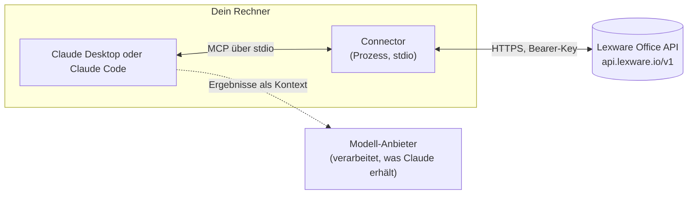
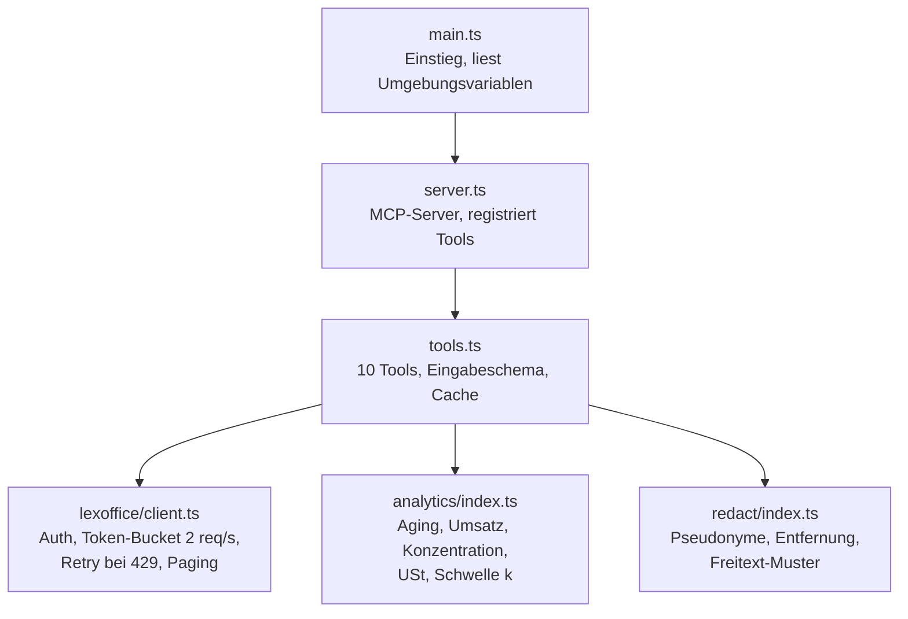
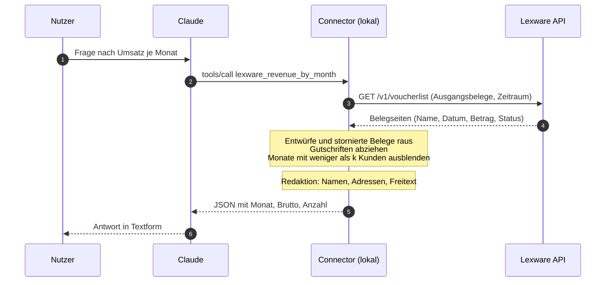
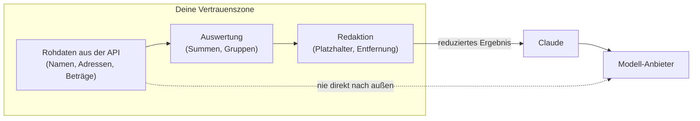
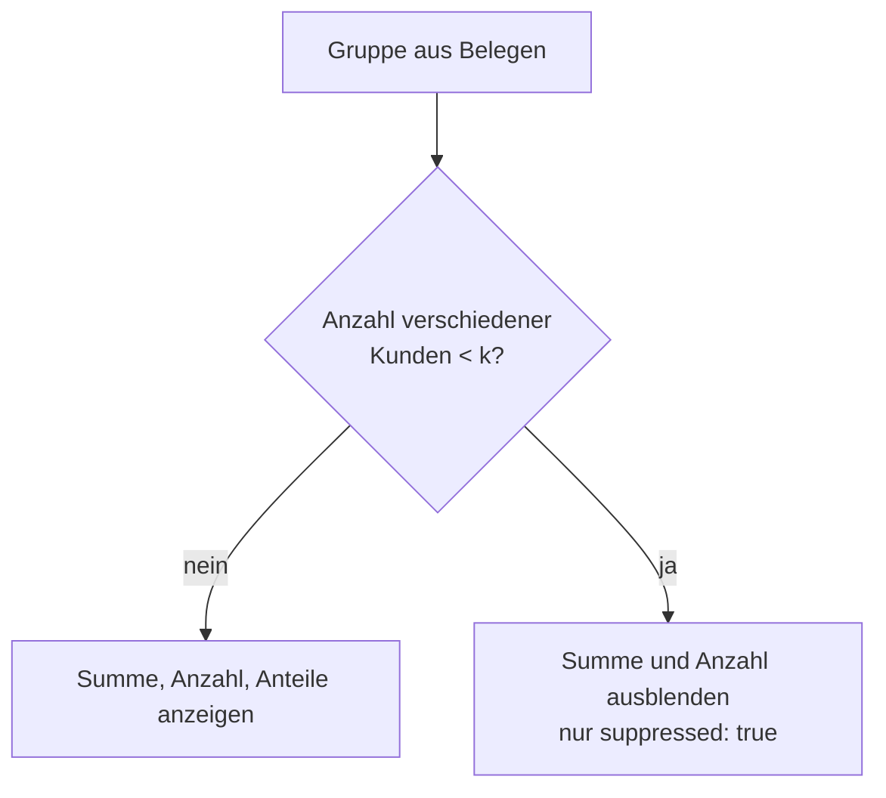

# Architektur

Diese Seite beschreibt, wie der Connector aufgebaut ist, wie eine Anfrage durch ihn läuft und warum er so gebaut ist. Für die Tool-Parameter siehe [API.md](API.md), für den Datenschutz [SECURITY-PRIVACY.md](SECURITY-PRIVACY.md).

## Überblick

Der Connector ist ein kleiner Prozess auf deinem Rechner. Claude startet ihn über das Model Context Protocol (MCP) und spricht mit ihm über stdin und stdout. Er ruft die Lexware-API über HTTPS ab, berechnet die Auswertungen lokal und gibt nur reduzierte Ergebnisse zurück.

Die gestrichelte Linie ist wichtig: Sobald Claude Ergebnisse verarbeitet, gehen sie an den Modell-Anbieter. Der Connector reduziert, was dort ankommt. Er kann das nicht vollständig verhindern.

## Komponenten

| Datei | Aufgabe |
|---|---|
| `src/main.ts` | Liest `LEXOFFICE_API_KEY`, `LEXWARE_REDACT`, `LEXWARE_MIN_GROUP`, baut Client und Redaktor und startet den stdio-Transport. Fehler gehen nach stderr, stdout gehört dem MCP-Protokoll. |
| `src/server.ts` | Registriert jedes Tool mit Beschreibung, Eingabeschema und Hinweis `readOnlyHint`. |
| `src/tools.ts` | Definiert die zehn Tools. Hier wird die Antwort geschwärzt, bevor sie den Connector verlässt. |
| `src/lexoffice/client.ts` | Spricht mit der Lexware-API: Bearer-Auth, Drosselung, Wiederholung bei 429, Paging. |
| `src/analytics/index.ts` | Reine Funktionen für die Auswertungen. Keine Netzwerkaufrufe, deshalb gut testbar. |
| `src/redact/index.ts` | Ersetzt Namen durch Platzhalter, entfernt Adressen und Steuer-IDs, ersetzt Muster im Freitext. |

## Ablauf einer Anfrage

Beispiel: „Wie hat sich der Umsatz je Monat entwickelt?“

Die Auswertung rechnet auf den Rohdaten, die Redaktion kommt danach. So bleibt die Rechnung korrekt, und das Ergebnis enthält trotzdem keine Namen.

## Datenfluss und Vertrauensgrenzen

Die Rohdaten verlassen den Connector nie. Was Claude erhält, ist das Ergebnis nach Auswertung und Redaktion.

## Auswertungen und Schwelle

Eine Auswertung zeigt eine Gruppe erst, wenn sie genug verschiedene Kunden enthält. Standard ist fünf. Darunter wird die Gruppe ausgeblendet, damit eine Zahl nicht auf einen einzelnen Kunden zurückführt.

Für die USt-Übersicht zählt statt der Kunden die Zahl der Rechnungen. Rechnungen ohne jede Steuerzeile fließen nicht in die Sätze ein. Sie erscheinen in einer eigenen Liste mit Anzahl, Nettosumme und Rechnungsnummern. Ein Steuersatz wird nicht erfunden.

## Wichtige Entscheidungen

| Entscheidung | Warum | Konsequenz |
|---|---|---|
| Lokaler MCP-Server statt Hosting | Der API-Key und die Firmendaten bleiben beim Nutzer. Kein Server von uns, kein Auftragsverarbeitungsvertrag nötig. | Jeder Nutzer braucht Node.js und den eigenen Key. |
| Nur lesend | Schreibzugriff auf Buchhaltung ist riskant und nicht rückgängig zu machen. | Keine Rechnungen anlegen oder finalisieren. |
| Nur Ausgangsbelege wählbar | Eingangsbelege, Buchungsbelege und Lohndaten sollen gar nicht erreichbar sein. | Die Eingabe ist auf sechs Ausgangsbelegtypen begrenzt. |
| Redaktion standardmäßig an | Die Datensparsamkeit soll der Normalfall sein, nicht eine Option, die man vergisst. | Namensuche liefert Platzhalter. Mit `LEXWARE_REDACT=0` sieht man Klarnamen. |
| Schwelle k = 5 | Kleine Gruppen können auf eine Person zurückführen. | Bei kleinen Testdaten sieht man nichts, bis `LEXWARE_MIN_GROUP=1` gesetzt ist. |
| Kein Cache auf der Platte | Keine Daten bleiben nach dem Beenden liegen. | Detailabrufe wiederholen sich nach jedem Neustart. |
| Keine Erfindung von Steuersätzen | Die steuerliche Einordnung ist Sache der Steuerberatung. | Rechnungen ohne Steuerzeilen werden separat ausgewiesen. |

## Fehlerbehandlung

- Die API-Aufrufe geben bei HTTP-Fehlern nur Status und Pfad an. Der Antworttext der Lexware-API wird nicht weitergereicht, damit keine Daten in Fehlermeldungen landen.
- Ein Tool-Fehler kommt als `isError: true` mit einer kurzen Meldung zurück. Der Connector beendet sich dabei nicht.
- Der API-Key erscheint in keiner Meldung.

Typische Fehler und ihre Lösung stehen in [TROUBLESHOOTING.md](TROUBLESHOOTING.md).

## Tests

Die Tests liegen unter `test/` und laufen mit Vitest, ohne echte API:

| Datei | Prüft |
|---|---|
| `client.test.ts` | Auth-Header, Drosselung, Wiederholung bei 429, Paging, keine Schlüssel in Fehlern |
| `analytics.test.ts` | Summen, Aging, Umsatz je Monat, USt |
| `threshold.test.ts` | Schwelle k, Konzentration, Umgebungsvariable |
| `vat-coverage.test.ts` | Rechnungen ohne Steuerzeilen |
| `redact.test.ts` | Pseudonyme, Entfernung, Freitext-Muster, Umschalter |
| `tools.test.ts` | Tool-Liste, Eingabeschema, Cache, Redaktion im Tool |
| `server.test.ts` | MCP-Server über In-Memory-Transport |
