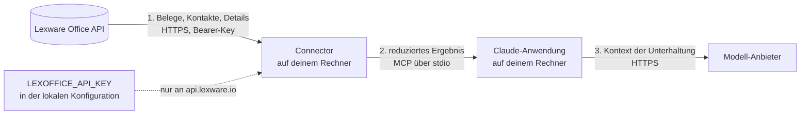

# Sicherheit und Datenschutz

Diese Seite beschreibt, welche Daten wohin fließen, welche Schutzmaßnahmen der Connector ergreift und wo die Grenzen liegen. Sie ist keine Zertifizierung, keine Rechtsberatung und keine Garantie. Die Entscheidung, ob ein Einsatz zu deinen Daten passt, liegt bei dir oder deinem Verantwortlichen.

## Datenflüsse

| Schritt | Was fließt | Wohin | Wer sieht es |
|---|---|---|---|
| 1 | Rohdaten aus Lexware (Namen, Adressen, Beträge, Notizen) | Connector, nur im Arbeitsspeicher | Nur dein Rechner |
| 2 | Reduziertes Ergebnis (Platzhalter, Summen, Anzahl) | Claude-Anwendung | Dein Rechner |
| 3 | Was Claude als Kontext verarbeitet | Modell-Anbieter | Anbieter, nach dessen Bedingungen |

Der Connector sendet an keinen anderen Dienst. Es gibt keine Telemetrie, keine Analyse und keine Logdateien mit Personendaten. Fehlermeldungen enthalten keine Daten aus der Antwort.

## Schutzmaßnahmen

| Maßnahme | Standard | Was sie tut | Was sie nicht tut |
|---|---|---|---|
| Namen-Pseudonyme | an | Ersetzt Person-, Firmen- und Kontaktnamen durch `Kontakt N`. Ein Name hat im Prozess immer dieselbe Nummer. | Pseudonyme sind nicht anonym, die Zuordnung existiert im Prozess. |
| Adressen | an | Entfernt Straße, Adresszusatz und PLZ. Ort und Land bleiben. | Ort und Land können bei kleinen Orten identifizieren. |
| Steuer-IDs | an | Entfernt Steuernummer und USt-IdNr. | Andere Kennungen wie Lexware-IDs bleiben. |
| Freitext-Muster | an | Ersetzt E-Mail-Adressen, IBANs, Telefonnummern und USt-IdNr. in allen Textfeldern. | Erkennt keine Namen im Text. |
| Schwelle k | 5 | Blendet Auswertungen mit weniger als fünf verschiedenen Kunden aus. | Schützt nicht gegen Kombinationen aus mehreren Auswertungen bei sehr kleinen Stämmen. |
| Konzentration ohne Namen | immer | Gibt nur Anteilsklassen der drei größten Kunden aus, keine Namen, keine Beträge. | – |
| Nur Ausgangsbelege | immer | Eingangs-, Buchungs- und Lohnbelege sind über die Tools nicht abrufbar. | – |
| Nur lesend | immer | Der Connector kann nichts an Lexware ändern. | – |
| Keine Speicherung | immer | Pseudonyme und Detail-Cache existieren nur im Arbeitsspeicher. | – |

Die Schalter `LEXWARE_REDACT=0` und `LEXWARE_MIN_GROUP=1` schalten Schutzmaßnahmen ab. Setze sie nur bewusst und nur, wenn du Klarnamen oder kleine Gruppen wirklich brauchst.

## Bekannte Lücken

Diese Punkte sind absichtlich benannt, damit niemand sie übersieht:

1. **Namen im Freitext.** Notizen, Titel, Einleitungen und Positionsbeschreibungen werden nur auf E-Mail, IBAN, Telefon und USt-IdNr. geprüft. „Rücksprache mit Frau Musterfrau“ bleibt unverändert.
2. **Lexware-IDs.** Die Kontakt-ID (`contactId`) ist ein stabiler Schlüssel und bleibt in den Antworten. Wer Zugriff auf das Konto hat, kann sie zuordnen.
3. **Belegdaten.** Rechnungsnummern, Datumsangaben und Beträge bleiben. Bei kleinen Kundenstämmen kann eine Kombination aus Datum und Betrag auf eine Firma hinweisen.
4. **Pseudonyme sind personenbezogen.** Solange die Zuordnung existiert, lassen sich die Platzhalter zurückführen. Das reduziert das Risiko, macht die Daten aber nicht anonym.
5. **Kombinationen.** Mehrere Auswertungen zusammen können einen Kunden eingrenzen, auch wenn jede für sich die Schwelle erfüllt.
6. **Klartext im Konfigurationsdatei.** Der API-Key steht im `env`-Block der Claude-Konfiguration als Klartext. Wer diese Datei lesen kann, kann den Key lesen.
7. **Modell-Anbieter.** Was Claude erhält, verarbeitet der Anbieter. Der Connector hat darauf keinen Einfluss.

## Empfehlungen für den Betrieb

- **Eigenen Key pro Einsatz anlegen** und bei Bedarf in Lexware Office widerrufen.
- **Einen Testaccount nutzen**, bevor echte Daten angebunden werden.
- **Schwelle und Redaktion nicht abschalten**, außer es gibt einen konkreten Grund.
- **Auswertungen für die Geschäftsführung nur aggregiert** verwenden, also ohne Einzelkunden.
- **Die Konfigurationsdatei schützen**, zum Beispiel mit Dateirechten auf dem eigenen Konto.
- **Den Key ausschließlich über die Konfiguration übergeben**, nie in ein Repository, eine Chat-Nachricht oder einen Screenshot.
- **Bei Verdacht auf Missbrauch** den Key in Lexware Office sofort erneuern.

## Sicherheitsmeldungen

Bitte melde Sicherheitsprobleme nicht öffentlich als Issue. Nimm stattdessen Kontakt über [m-ko.de](https://m-ko.de) auf.
